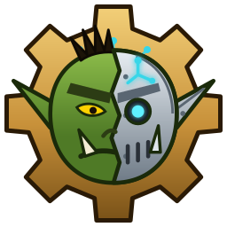

<p align="center">
  
</p>

# OpenGlider

OpenGlider is a modular bot engine for World of Warcraft clients, written in
C++20.

## Modules

Each directory is a static library, `og_<module>`. A module only sees the
modules it lists as dependencies:

| Module       | What it holds                                                  |
|--------------|----------------------------------------------------------------|
| `common`     | math, clock, logging, events, JSON, blacklists                 |
| `state`      | `GameSnapshot`, `IGameStateProvider`, a mock provider          |
| `input`      | `IInputBackend` and its backends                               |
| `actions`    | semantic actions mapped to input                               |
| `navigation` | routes, the movement controller, stuck handling, client maps   |
| `targets`    | target filtering and scoring                                   |
| `profiles`   | area, No Go zones, obstacles; load, save, validate, edit       |
| `combat`     | the combat class interface and the OGScript language           |
| `core`       | `BotEngine`, behaviors, the objective stack, `BotInstance`     |
| `tasks`      | task plans and the plan executor                               |
| `world`      | the quest database, quest givers, clustering and scoring       |
| `ai`         | strategic and tactical planners                                |
| `replay`     | snapshot recording and a replay provider                       |
| `sim`        | a simulated world for offline testing                          |
| `wowclient`  | reading the client's memory (1.12.1 and 3.3.5a layouts)        |
| `minimap`    | the client's minimap tiles (with StormLib or CascLib)          |


## Building

OpenGlider builds on its own into one shared library: `libopenglider.so` on
Linux, `OpenGlider.dll` on Windows. CMake 3.24 and a C++20 compiler are needed;
missing dependencies (SQLite, yaml-cpp, StormLib, CascLib, Recast/Detour) are
fetched.

```sh
cmake -S . -B build -DCMAKE_BUILD_TYPE=Release
cmake --build build --parallel
# build/lib/libopenglider.so
```

A program built against these headers can run with a library you built from
modified sources. At start it can check that the library was built from the
same headers (`og/abi/EngineAbi.h`): one that was not would crash it. Changes
to `.cpp` files fit; a change to a header that alters a type the program
shares (a field added to `GameSnapshot`, say) does not.

The application's name (which names its config directories) and its data
directory are told to the engine by the program (`setApplicationName`,
`setDataDirectory`); a library built on its own does not know them.

[docs/CustomEngine.md](docs/CustomEngine.md) is the full guide: running a
program with your build, which changes work and which do not, where things
are, recipes, and how the check works.

## License

Copyright (c) 2026 Alexander Blohmè.

OpenGlider is free software: you can redistribute it and/or modify it under the
terms of the GNU Lesser General Public License as published by the Free
Software Foundation, either version 3 of the License, or (at your option) any
later version. See [COPYING.LESSER](COPYING.LESSER) and [COPYING](COPYING).
